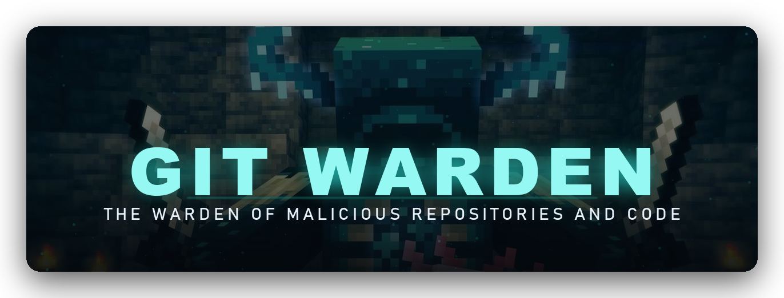
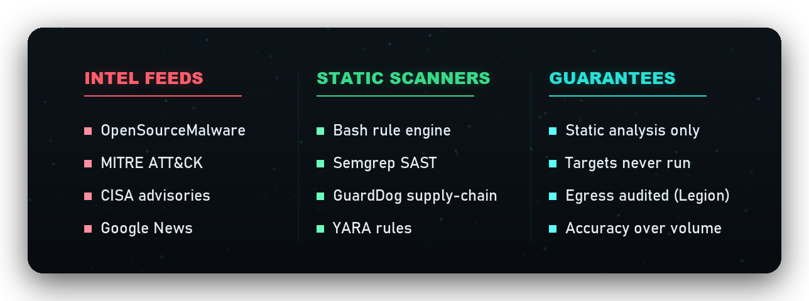
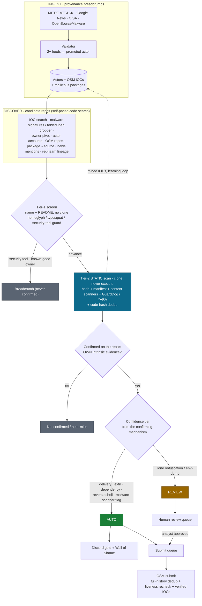
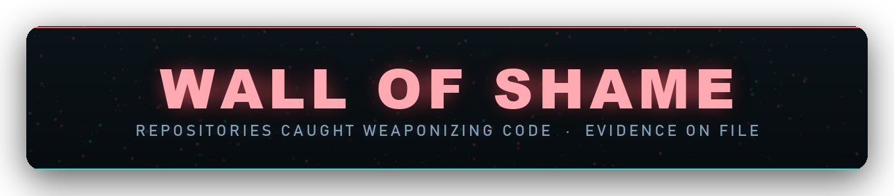
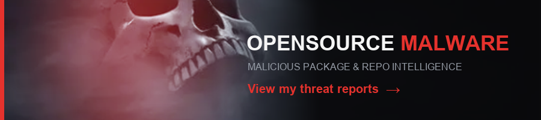

<p align="center">
  
</p>

<p align="center">
  
  <a href="LICENSE"></a>
  <a href="https://www.python.org"></a>
</p>

<p align="center">
  
</p>

> **The Warden cannot see. It listens for what code *does*.**
> Git Warden never executes a target; it reads the code statically and senses the
> behaviors that betray malice, the way the Warden senses vibration in the dark.

A defensive threat-intelligence engine that discovers, analyzes, and catalogs
**malicious GitHub repositories**. Threat-intel feeds
([MITRE ATT&CK](https://attack.mitre.org), [Google News](https://news.google.com),
[CISA](https://www.cisa.gov), [OpenSourceMalware](https://opensourcemalware.com))
are *provenance breadcrumbs*; they help find and attribute the repos. The product
is the registry of malicious repos.

The root README is the product overview. The engineering contract lives in
[docs/README.md](docs/README.md): architecture, finding storage, team-hunt
orchestration, and OSM submission. Guiding principle: **accuracy over volume.**

<p align="center"></p>

## How it works

Provenance feeds seed **who** and **what** to look for. A self-paced discovery
layer finds candidate repos. A two-tier static analysis confirms malice on the
code's own evidence, and a **confidence tier** decides what is submit-ready versus
what waits for a human. Nothing is ever executed.

**Sandboxed by default.** Tier-2 clones and scans each repo inside a hardened,
throwaway Docker container, so a downloaded repo's malware never touches the host.
The clone lives only in the container's RAM, the container runs read-only, non-root,
with no capabilities and no host folder mounted, and only the findings return as
JSON. This mirrors Knörr's container sandbox. If Docker is not available, Tier-2 is
disabled rather than cloning onto the host. Set `GW_SANDBOX=0` only on a trusted CI
box.



**The spine: confidence tiering.** A finding's confirming mechanism sets its tier,
and **only `AUTO` reaches Discord gold and the submit queue**:

| Tier | Confirmed on | What happens |
|------|--------------|--------------|
| **AUTO** | a delivery, exfil, or dependency mechanism: a folderOpen `curl \| bash`, an install-hook fetch-and-run, a reverse shell, steal-and-send, an OSM-listed dependency, or a malware-scanner flag | gold plus submit-eligible |
| **REVIEW** | a lone broad signal: standalone obfuscation or decode-exec, or a bare env-dump | stored for a human, never auto-gold or auto-submit |
| **none** | recon only, a security or red-team tool's own code, or nothing | breadcrumb, dropped |

This is why a localhost health check, or a tutorial's example command, cannot reach
the queue. The noise lands in `REVIEW` or is dropped by design, not by patching each
pattern one at a time. A [golden fixture corpus](tests/fixtures/precision/) gates
AUTO-tier precision in CI, so a rule change cannot silently bring back a known false
positive.

<p align="center"></p>

## Working with Knörr

Git Warden and KNÖRR are separate detectors joined by a narrow intelligence bus.
Warden owns **repository findings**. KNÖRR owns **container findings**. Neither
tool inherits the other's verdict.

During a joint hunt, Warden writes repository state to
`ci-state/git_warden.sqlite`, KNÖRR writes container state to
`ci-state/knorr.sqlite`, and both exchange campaign breadcrumbs through
`ci-state/breadcrumbs.jsonl`.

The bus carries C2 hosts, malicious packages, code/path fingerprints,
repository↔image links, and prior-submission markers. A breadcrumb can start a new
search; it cannot confirm a target. Each tool must independently validate the
surface it owns.

The production joint workflow, approval boundary, and storage model are documented
in [docs/team-hunt.md](docs/team-hunt.md) and
[docs/finding-storage.md](docs/finding-storage.md).

<p align="center"></p>

## Wall of Shame

<p align="center">
  
</p>

Repositories Git Warden confirmed malicious by static analysis, refreshed on
every run. A repo confirms only on intrinsically malicious evidence
(`eval(atob(...))` injected into a build config, a reverse shell, a credential
steal-and-send); threat-intel leads (a malicious owner, a shared signature) only
*seed* which repos get scanned, never confirm one alone.

<!-- git-warden:registry:start -->
_Top 10 of 43 repositories confirmed malicious by static analysis this run, ranked by severity. The full list ships as the run's CSV artifact and to the Discord feed; every row's evidence (file, line, rule) is in that CSV. Dispute: open an issue and we will re-review._

| Repository | Detection | Score | Attribution | Proof (file:line rule) |
|------------|-----------|-------|-------------|------------------------|
| [`eastmade/web3project-momo-token`](https://github.com/eastmade/web3project-momo-token) | signature_match | 22 | unattributed | .vscode/tasks.json:0 install_hook/vscode-autorun  (+11 more) |
| [`gauravraisharma/ticketting-system`](https://github.com/gauravraisharma/ticketting-system) | signature_match | 15 | unattributed | .vscode/tasks.json:0 install_hook/vscode-autorun  (+19 more) |
| [`huncholane/defi_property`](https://github.com/huncholane/defi_property) | signature_match | 15 | unattributed | .vscode/tasks.json:0 install_hook/vscode-autorun  (+12 more) |
| [`mohamedeturki/shigud-clone`](https://github.com/mohamedeturki/shigud-clone) | signature_match | 15 | unattributed | .vscode/tasks.json:0 install_hook/vscode-autorun  (+4 more) |
| [`agrawalchirag/corex`](https://github.com/agrawalchirag/corex) | signature_match | 13 | unattributed | .vscode/tasks.json:0 install_hook/vscode-autorun  (+4 more) |
| [`ricardomartins9899/smartpay-demo`](https://github.com/ricardomartins9899/smartpay-demo) | signature_match | 13 | unattributed | .vscode/tasks.json:0 install_hook/vscode-autorun  (+5 more) |
| [`icecoldjay/bri`](https://github.com/icecoldjay/bri) | signature_match | 12 | unattributed | .vscode/tasks.json:0 install_hook/vscode-autorun  (+6 more) |
| [`lfirsl/morphix`](https://github.com/lfirsl/morphix) | signature_match | 12 | unattributed | .vscode/tasks.json:0 install_hook/vscode-autorun  (+13 more) |
| [`nelsondev19/defi-property`](https://github.com/nelsondev19/defi-property) | signature_match | 12 | unattributed | .vscode/tasks.json:0 install_hook/vscode-autorun  (+12 more) |
| [`itsmeblackops/wisepanda-bot-main`](https://github.com/itsmeblackops/wisepanda-bot-main) | signature_match | 11 | unattributed | .cursor/tasks.json:0 install_hook/vscode-autorun  (+5 more) |
<!-- git-warden:registry:end -->

> [!NOTE]
> Every row's evidence (file, line, and the rule that fired) is in the per-run
> artifacts, so each listing is falsifiable. **Dispute a listing:** open an issue
> with the repository name and we will re-review and remove false positives.

<p align="center"></p>

## Bad Owners

Repositories whose **owner** ships malware we confirmed elsewhere, but which carry
no malicious evidence in their *own* code. Owner reputation is a provenance
breadcrumb, not proof, so these never reach the Wall of Shame above or the report
queue. They are listed here as elevated risk, with the owner's evidence-confirmed
repos as the provenance.

<!-- git-warden:badowners:start -->
_These repositories are NOT confirmed malicious on their own code. They appear only because their OWNER also publishes repositories we confirmed by static evidence (linked below, and on the Wall of Shame). Owner reputation is a provenance breadcrumb, not proof, so these never enter the registry or the report queue; treat them as elevated risk pending their own review._

| Repository | Owner | Owner provenance (repos confirmed on evidence) | Score |
|------------|-------|------------------------------------------------|-------|
| _none_ |  |  |  |
<!-- git-warden:badowners:end -->

<p align="center"></p>

## Attribution

Confirmed repos are attributed to a **country of origin** by a multi-signal engine,
not a single tag. Git Warden names a country only on **2+ independent evidence
signals** (Contagious-Interview tradecraft, C2-infrastructure overlap with prior
campaign repos, a decoded BeaverTail/InvisibleFerret family fingerprint, or a
known-malicious dependency) **or** a specific named-group intel attribution (APT28,
Lazarus, Kimsuky, ...). A lone tradecraft vector or a bare nation tag stays a *lead*,
never an assertion, so a copycat is never over-attributed.

Each finding carries a confidence tier (confirmed / probable / possible /
unattributed) with the exact evidence listed, so every attribution is falsifiable.
The 18 seeded actors map to five origins (North Korea, Russia, China, Iran,
Cybercrime); adding a country is a data entry, and North Korea (Contagious Interview)
carries full evidence detectors today.

<p align="center"></p>

## Quick start

```bash
make install                     # pip install -e ".[dev]"  (or skip it: python gw.py <cmd>)
cp .env.example .env             # add GW_GITHUB_TOKEN, GW_OSM_API_KEY, ...
```

Credentials load from `.env` automatically (real env vars win). Tokens:

| Var | What | Notes |
|-----|------|-------|
| `GW_GITHUB_TOKEN` | GitHub PAT, **read-only public** | required for code search + 5k/hr |
| `GW_OSM_API_KEY` | OpenSourceMalware token (`osm_…`) | Bearer auth |
| `GW_DISCORD_WEBHOOK` | gold/alert channel | confirmed findings only |

(No NVD key needed; free OSINT feeds + OSM cover the intel sources for now.)

## Commands

A `Makefile` wraps the common flow (`make help` lists every target). It runs the
same on Linux and Windows, shelling out only to Python so there is no
bash-vs-cmd dependency (on Windows: Git Bash, scoop, or `choco install make`):

```bash
make ingest                      # feeds -> actors + OSM artifacts
make iocs                        # IOC pivot set mined from OSM
make discover                    # IOC code search -> new repos
make hunt                        # full pipeline -> Wall of Shame -> Discord (LIMIT=N caps it)
make review                      # list confirmed repos (ARGS="--approve owner/repo")
make revalidate                  # re-scan confirmed findings; demote fixed false positives
make queue                       # show the AUTO-tier submit queue (ready to review)
make serve                       # live telemetry dashboard
make check                       # lint + tests, run before pushing
```

Each target is a thin wrapper over the CLI, so without make you run it directly
(`python gw.py <cmd>`, or the installed `git-warden <cmd>`):

```bash
python gw.py ingest                         # feeds -> actors + OSM artifacts
python gw.py iocs                            # IOC pivot set mined from OSM
python gw.py discover                        # IOC code search -> new repos
python gw.py lineage --tool Sliver --screen 12   # red-team clones + Tier-1
python gw.py screen-artifacts                # Tier-1 over OSM repo scan-list
python gw.py hunt --scan --gold              # full pipeline -> Wall of Shame -> Discord
python gw.py review --approve owner/repo     # analyst-validate a confirmed repo
python gw.py probe --feed github --term lazarus  # probe any feed live
```

**Watching a run.** In a terminal, `hunt` shows a live, plain-language progress
view: per-source discovery counters, Tier-1/Tier-2 progress, and a run-number plus
a learning-corpus delta so you can see the yield compound across runs. It collapses
each run to four buckets: *repos scanned, signatures matched, code analysis passed,
queued for review.* Force it with `--progress on`, silence it with `--progress off`
(it auto-detects a terminal, so CI stays quiet). **Git Warden is iterative**: run 1
sets a baseline, and most batches reach high yield by run 3 as the corpus compounds.

**Long runs.** Code search self-paces under GitHub's secondary rate limit, so a slow,
methodical sweep keeps discovering instead of quitting after a burst. Tune the pace
with `GW_SEARCH_MIN_INTERVAL` (seconds between searches, default 8; raise it if you
still get throttled). Add `--resume` to a re-run so it skips repos already scanned and
continues where it stopped. Turn on full-verbosity logging for debugging with
`GW_LOG_LEVEL=DEBUG`, which surfaces the per-candidate decision log (why each repo was
confirmed, screened, or rejected).

## Dashboard

A live, read-only **telemetry dashboard** for exploring the registry visually,
built for data-driven review without touching the CLI:

```bash
make serve                       # or: python gw.py serve
#  ->  http://127.0.0.1:8787
```

It renders the **discovered product** as a force-graph (OSM re-validations are
hidden, so you see only what Git Warden surfaced):

- **Every repo is colored by attribution confidence**: confirmed (red), probable
  (orange), possible (yellow), unattributed (purple), clustered under its
  **origin-country hub** (North Korea, Russia, China, Iran, Cybercrime).
- **Click any repo** for the full picture: the confirming `file:line` evidence, the
  country attribution with its independent signals, the decoded payload, the C2
  infrastructure, and a **container-threat** badge when the Docker build recipe is
  malicious.
- Side panels break down attack vectors, C2 infrastructure, source yield and
  precision, the run timeline, and rejected false positives.

Local use needs no auth. For a deployment, set `GW_DASHBOARD_TOKEN` to require a
bearer token on `/api/*` (every request is logged).

## Submit to OSM

Warden's production reporting path is fail-closed and runs through the joint
KNÖRR workflow. A normal hunt only produces an OSM preview. A submission run must
be explicitly dispatched with submission enabled and then approved through the
protected `osm-submission` GitHub Environment.

After approval, Warden accepts only the exact repository list shown in the
preview, re-runs the hardened static validation, checks the current repository,
calls OSM's `check-malicious` endpoint again, and only then may call
`POST /submit-threat-report`. A changed, removed, already-reported, or inconclusive
repository is dropped.

Local analyst tooling remains available through `python -m git_warden.osm_submit`.
The unattended policy and joint CI path are documented separately in
[docs/submit.md](docs/submit.md).

## Deployment

GitHub Actions are split by responsibility:

| Workflow | Responsibility |
|---|---|
| `ci.yml` | lint and tests |
| `security.yml` / Zizmor checks | repository and workflow security checks |
| `run.yml` | Warden ingest/hunt execution |
| `osm-automation-gate.yml` | deterministic OSM policy/tests/lint/sandbox gate |
| `osm-automation.yml` | manual recovery path for standalone Warden OSM automation |
| KNÖRR `joint-threat-hunt.yml` | canonical joint hunt and production OSM preview/submission |

The joint workflow runs on GitHub-hosted runners hardened with Legion. It supplies
the shared OSM credential to both engines, restores their separate SQLite state,
and points both intelligence variables at the same append-only JSONL bus.

Local configuration uses `GW_*` environment variables. Repository secret names are
workflow plumbing and are intentionally kept out of the core configuration
contract.

See [docs/architecture.md](docs/architecture.md) and
[docs/team-hunt.md](docs/team-hunt.md) for the control-plane design.

## Development

```bash
make check                       # ruff + pytest (run before pushing)
make fmt                         # auto-fix lint findings
```

Or invoke the tools directly: `ruff check src tests gw.py` and `pytest -q`.

<p align="center"></p>

<p align="center">
  <a href="https://opensourcemalware.com/my-submissions">
    
  </a>
</p>
