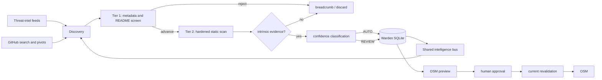

# Git Warden system design

## Scope

Git Warden is a static-analysis system for malicious GitHub repositories. It discovers candidate repositories, screens them cheaply, performs deeper static inspection in an isolated container, records evidence, correlates campaign infrastructure, and prepares high-confidence findings for external reporting.

The target is never executed.

## System boundary

Git Warden owns the repository side of the hunting system. KNÖRR owns container images. The two systems exchange narrow, append-only intelligence records but retain separate finding stores and separate confirmation logic.

## Components

### Discovery

Discovery answers one question: which repositories are worth inspecting?

Inputs include known malicious packages, repository references, code signatures, C2 infrastructure, threat-actor seeds, OSM records, red-team lineage, and shared breadcrumbs from KNÖRR. Discovery is intentionally permissive. A discovery hit is not a verdict.

### Tier 1

Tier 1 is a low-cost screen over repository metadata and content that does not require a clone. It removes obvious noise and known-good tooling before expensive analysis.

Tier 1 may promote a candidate to Tier 2. It cannot create an AUTO finding by itself.

### Tier 2

Tier 2 performs the confirming static scan in a hardened Docker container. The scanner may inspect source, manifests, task files, shell content, encoded payloads, YARA/GuardDog results, and repository structure.

Sandbox properties are part of the security contract:

- non-root process;
- read-only root filesystem;
- dropped capabilities;
- no host source directory mounted into the sandbox;
- ephemeral clone storage;
- no execution of the target;
- no host fallback when Docker is unavailable.

### Confirmation and confidence

Confirmation requires evidence originating in the repository under review. Examples include a download-and-execute path, credential theft followed by exfiltration, reverse-shell logic, malicious install hooks, a known-malicious dependency used by the repository, or a malware-scanner result tied to repository content.

Confidence then determines disposition:

| Confidence | Meaning | Automatic external reporting |
|---|---|---|
| AUTO | intrinsic confirming mechanism | eligible after all submission gates |
| REVIEW | suspicious but not sufficient for autonomous reporting | no |
| none | no confirming malicious behavior | no |

A threat-intel feed, owner reputation, or campaign association may raise priority. It does not substitute for intrinsic evidence.

### Campaign correlation

`correlate.py` groups confirmed repositories into campaigns by one of two fingerprints. Each campaign gets a stable id, `GW-C-<hash>`.

| Fingerprint | Example | Propagates attribution |
|---|---|---|
| `payload` | first 96 base64 characters of an `eval(atob(...))` loader stub | yes, from an already-attributed member |
| `dropper` | `vscode-folderopen:settings/{os}?flag=`: delivery vector plus the dropper URL path, with host, OS segment and parameter values removed | no |

The dropper fingerprint catches the folderOpen `tasks.json` lures. Those lures rotate to a throwaway C2 host per repository, so clustering by host splits them into one-repository groups. Reputable install hosts never produce a dropper fingerprint.

Every hunt records membership in `campaign_members`, which keeps the first and last run each repository was seen. The OSM automation run summary opens with a **Campaign correlation** table. It groups that run's validated repositories with every other confirmed member of the same campaign, and lists owners, C2 hosts and a representative command. The dashboard graph and `/api/campaigns` show the same clusters.

## Trust boundaries

### GitHub

GitHub is an untrusted content source. Repository data is input to the scanner, not code to run.

### Tier-2 sandbox

The sandbox is the containment boundary between untrusted repository content and the CI/host environment.

### Shared intelligence bus

The JSONL bus is a lead-exchange channel. Records are treated as hints until independently confirmed by the consuming tool.

### OSM

OSM is an external reporting system. Existing-report checks, authentication failures, malformed responses, or network failures cause submission to stop rather than continue optimistically.

## Failure model

Git Warden fails closed where a failure could change a reporting decision.

- No Docker: Tier 2 does not run.
- OSM lookup failure: candidate is not submitted.
- Repository cannot be revalidated: candidate is not submitted.
- Confidence drops below AUTO: candidate is not submitted.
- Existing OSM report found: candidate is not submitted.
- Shared-bus submission marker exists: candidate is not submitted.
- POST failure: local submission state is released so the item can be reviewed or retried safely.

## CI roles

The Warden repository CI proves the code and sandbox contract: tests, lint, policy checks, and sandbox build.

Scheduled hunts, weekly on Mondays (UTC): the KNÖRR joint hunt with OSM submission at 05:17, the VS Code extension hunt at 07:43, and The Warden hunt at 09:23 with the Minecraft mod/plugin stealer family searched first. Seeds that are already full code-search queries (quoted phrases or qualifiers) are sent verbatim, and hits on the focused family keep their slots ahead of the per-run candidate limit.

Live joint OSM validation is performed from the KNÖRR joint workflow with the shared production credential. Warden's standalone OSM workflow is retained as a manual recovery path, not the canonical production scheduler.
