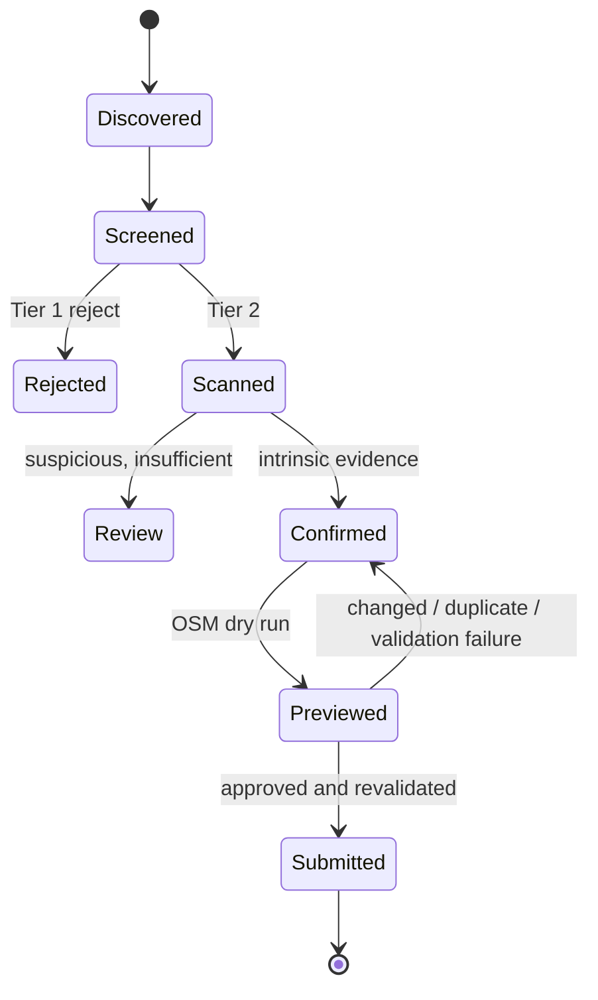

# Finding storage and lifecycle

## Ownership

Git Warden is the system of record for repository findings.

In a joint hunt:

| Data | Owner | Storage |
|---|---|---|
| repository finding | Git Warden | `git_warden.sqlite` |
| container finding | KNÖRR | `knorr.sqlite` |
| cross-tool breadcrumb | both | append-only `breadcrumbs.jsonl` |
| human-review evidence | workflow run | GitHub Actions artifacts |
| published external report | OSM | OSM threat record |

The shared bus does not replace either SQLite database. It carries correlation material only.

## Repository finding lifecycle



### Discovered

A repository entered the candidate set through search, package resolution, intelligence feeds, actor pivots, lineage, or the shared bus. This state carries provenance, not a malicious verdict.

### Scanned

The repository passed through Tier 2. Evidence is tied to the repository content that was inspected.

### Confirmed

The repository met the intrinsic-evidence bar. Confidence is stored separately; only AUTO findings are eligible for unattended submission.

### Previewed

The automation performed a dry-run validation and wrote the exact repository list that may cross the human approval boundary.

### Submitted

A successful OSM response is recorded locally and a `submitted` breadcrumb is written to the shared bus. Future runs use both OSM and the bus to avoid duplicate reporting.

## SQLite state

The database is the operational state store. It contains findings, run metadata, evidence references, confidence, review state, and submission state.

Within GitHub Actions, the joint workflow places Warden state at:

```
ci-state/git_warden.sqlite
```

The directory is persisted through the Actions cache between hunts. Cache persistence is operational convenience, not archival storage. GitHub may evict caches.

## Shared intelligence

The joint workflow places the bus at:

```
ci-state/breadcrumbs.jsonl
```

Typical record kinds include:

- `c2_host`
- `package`
- `path_fp`
- `code_sig`
- `link`
- `submitted`

The file is append-only. Consumers must tolerate duplicate or stale hints and re-confirm them against their own target surface.

## Evidence artifacts

Run artifacts are the human review surface. They are expected to contain summaries, per-run finding exports, and the OSM submission preview. They are not the database.

The storage split is deliberate:

- SQLite answers "what does Warden know?"
- JSONL answers "what should the other hunter know?"
- artifacts answer "what should a reviewer inspect from this run?"
- OSM answers "what was externally published?"
