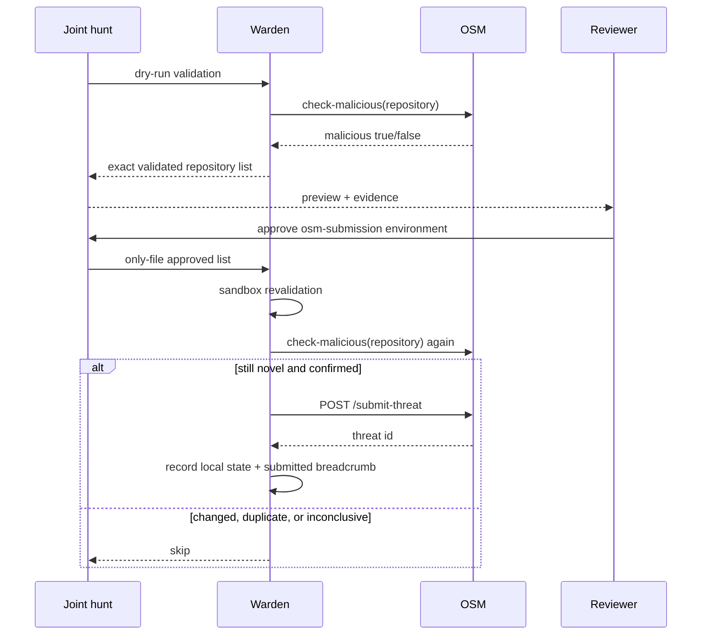

# OSM submission design

Git Warden reports only repository findings that survive a second, current validation pass.

The reporting path is deliberately separate from discovery. A repository can remain a confirmed Warden finding even when it is not eligible for OSM submission.

## API contract

The live integration uses the OSM functions API:

- exact resource check: `GET /check-malicious`
- create report: `POST /submit-threat`
- authentication: `Authorization: Bearer <token>`

Repository checks use:

```text
report_type=repository
resource_identifier=https://github.com/<owner>/<repo>
```

An authentication error, network failure, malformed response, or unexpected response shape blocks submission.

## Eligibility

A repository is eligible for unattended reporting only when all of the following are true:

1. its current Warden confidence is AUTO;
2. the repository has intrinsic confirming evidence;
3. the Tier-2 sandbox is available;
4. the repository still exists and can be revalidated;
5. the current scan still confirms the finding;
6. OSM does not already report the repository;
7. the shared intelligence bus does not contain a prior submission marker for the same resource;
8. the repository appears in the exact preview approved by the operator.

REVIEW findings are never promoted by the submitter.

## Joint submission flow

Production Warden reporting is coordinated by KNÖRR's joint workflow.



The preview list is a ceiling, not a command to submit. The second pass may submit fewer items.

## Human approval boundary

The protected GitHub Environment is named:

```
osm-submission
```

The operator reviews the uploaded Warden and KNÖRR previews before approving the deployment. Approval does not bypass confidence, novelty, liveness, sandbox, or evidence checks.

## Standalone Warden workflow

`.github/workflows/osm-automation.yml` remains available as a manual recovery path.

It is not the canonical production scheduler. The joint KNÖRR workflow is the preferred live path because both engines use the same validated OSM credential and the same shared-intelligence state.

## Duplicate prevention

Duplicate prevention is layered:

1. canonical resource variants are normalized;
2. OSM is queried before deep validation;
3. the target is revalidated;
4. OSM is queried again immediately before POST;
5. the shared bus is checked for a submission marker;
6. successful submission writes both local state and a shared `submitted` record.

No single local marker is treated as authoritative over OSM.

## Failure semantics

Submission is fail-closed.

| Failure | Result |
|---|---|
| Docker unavailable | skip |
| repository removed or unreadable | skip |
| current scan no longer confirms | skip |
| confidence below AUTO | skip |
| OSM 401/403 | stop |
| OSM network error | stop |
| unexpected OSM response | stop |
| duplicate found | skip |
| POST fails | release local claim; do not mark submitted |

## Local tooling

The local `osm_submit` command remains useful for analyst-driven review and manual reporting. The automated joint workflow uses `git_warden.osm_automation`, which enforces the unattended policy separately from the interactive path.
